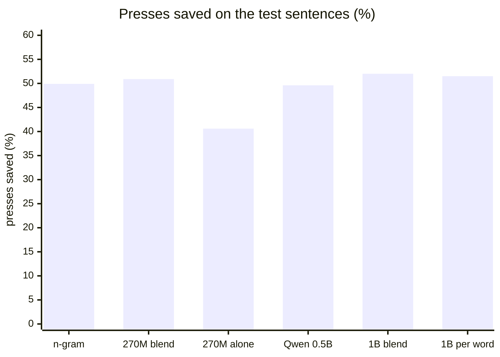

# Measuring the AI suggestions

How many presses word prediction saves, on 60 everyday Catalan messages
(`sentences_ca.txt`), simulating a user who types letter by letter and takes
the word as soon as it is offered. Rules are tuned on the odd sentences and
reported on the even ones.

    tools/fetch_ai_model.sh                       # once
    cd tools/ai_eval
    AI_MODEL=gemma3-270m .venv/bin/python -I compare.py
    AI_MODEL=gemma3-270m .venv/bin/python -I firsttoken.py   # once-per-word scoring

Other models go in `models/<name>/` (an ONNX export plus tokenizer.json);
Gemma 3 1B was `onnx-community/gemma-3-1b-it-ONNX`, `onnx/model_q4.onnx`.
`AI_THREADS=0` uses every core (for quality only); `AI_POOL` sets how many
n-gram words the model may reorder.

## Results, October 2026 (test half; presses saved)

| | saved | speed (2 laptop cores) |
|---|---|---|
| n-gram, as the app does today | 49.9% | — |
| Gemma 3 270M, blended (what the AI build does) | 50.9% | ~85 ms per keystroke |
| Gemma 3 270M, reorders everything | 40.6% | |
| Qwen 2.5 0.5B, blended | 49.6% | |
| Gemma 3 1B, blended | 52.0% | ~2 s per keystroke: too slow for a tablet |
| Gemma 3 1B, once per finished word | 51.2–51.8% | ~330 ms per word, then instant |

The axis starts at zero on purpose: the gains are small and the chart should
look it. "1B per word" is the middle of its 51.2–51.8% range.

Small gains, and 30 test sentences is few, so part of any one-point
difference may be chance. Full tables in `results-*.json`.
